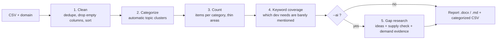

<div align="center">

# 🔍 Gap-Analysis Mate

**Feed it a dataset of what already exists. Get back what is missing.**

Clean · Categorize · Count · Find the gaps — for any ecosystem of plugins, extensions or tools.

`Python 3.10+` · `pandas` · `scikit-learn` · `works offline` · `AI mode optional`

</div>

---

## Why this exists

Before you build a plugin, an extension or a tool, you want to know one thing: **is anyone already doing this, and does anyone actually need it?**

Answering that by hand means scrolling through thousands of listings. Gap-Analysis Mate does the counting for you, and (optionally) asks an AI to propose what is missing, then **checks every idea against your data and the web** instead of trusting the model's guess.

It was built while studying the *DeepSeek Harness* plugin ecosystem (~20,000 GitHub repos and ~12,000 marketplace listings), but it works on **any CSV** of items with a name and a description: VS Code extensions, Chrome extensions, npm packages, MCP servers, Obsidian plugins, and so on.

## What it does



| Step | What happens | Needs an API? |
|---|---|---|
| 1. Clean | Removes empty columns, exact duplicates, and copies that only differ by name; sorts by popularity if a `stars`-like column exists | No |
| 2. Categorize | Groups every row into topic clusters (TF‑IDF + SVD + k‑means). Owner names and domain-wide words are ignored so one author can't create a fake category | No |
| 3. Count | Items per category, with `THIN` and `ONE-OWNER` flags | No |
| 4. Keyword coverage | Counts how many items mention ~35 common developer needs (testing, code review, CI, debugging, docs, Docker…) with examples. Low or zero = candidate gap | No |
| 5. Gap research | An LLM proposes missing products; each idea is compared with its closest existing items and with web results, then rated | Yes (`--ai`) |

### The rule that keeps it honest

An AI will happily say *"nothing like this exists"* without looking. So every idea in the report carries two kinds of evidence:

- **Supply:** the 5 closest existing items in *your* data, with similarity scores.
- **Demand:** real URLs from a web search that show people asking for it.

An idea with **no verified demand link is automatically labelled `WEAK`**, and URLs the model invents are discarded. Labels are `STRONG`, `MEDIUM` or `WEAK`. Treat all of them as hypotheses, not verdicts.

## Quick start

```bash
git clone <your-repo-url>
cd gap-analysis-mate
python -m venv .venv

# Windows PowerShell
.venv\Scripts\Activate.ps1
# macOS / Linux
source .venv/bin/activate

pip install -r requirements.txt
```

Run it on any CSV (no API key needed):

```bash
python gap_agent.py data.csv --domain "VS Code extensions" --name-col name --desc-col description
```

Outputs, next to your CSV:

- `data_gap_report.docx` and `data_gap_report.md`: the full report
- `data_gap_categorized.csv`: your data plus a `category` column

### Example output (illustrative)

```
Items per category:
                    label  count   flag
        remote / mobile    1658
         theme / skin       1593
         usage / token       814
                  memory      502
        reasoning effort      214  THIN

Keyword coverage (lowest first):
      term  count
   testing      0
    lint        1
```

## Options

| Option | Meaning |
|---|---|
| `--domain "…"` | **Required.** What the data is about. Its words are ignored when categorizing |
| `--name-col`, `--desc-col` | Column names. Auto-detected if omitted, but explicit is safer |
| `--categories N` | Number of topic groups (default 25) |
| `--ignore "a,b"` | Extra words to ignore when categorizing |
| `--probe "a,b"` | Your own keywords for the coverage table (replaces the default list) |
| `--keep-same-desc` | Keep rows that only share a description with another row |
| `--ai` | Turn on AI gap research |
| `--similar "…"` | Comma list of comparable ecosystems, e.g. `"Chrome extensions, JetBrains plugins"` |
| `--ideas N` | How many gap ideas to examine (default 10) |
| `--out NAME` | Output file base name |

## AI mode

Works with any **OpenAI-compatible** provider (OpenAI, DeepSeek, Gemini, Groq, OpenRouter, …). Check your provider's docs for the exact base URL and model name, and check its current pricing or free tier before running large jobs.

```powershell
# Windows PowerShell
$env:LLM_API_KEY  = "your-key"
$env:LLM_BASE_URL = "https://<provider>/v1"
$env:LLM_MODEL    = "<model-name>"
$env:TAVILY_API_KEY = "your-search-key"     # optional, enables demand evidence
```

```bash
# macOS / Linux
export LLM_API_KEY="your-key"
export LLM_BASE_URL="https://<provider>/v1"
export LLM_MODEL="<model-name>"
export TAVILY_API_KEY="your-search-key"
```

```bash
python gap_agent.py data.csv --domain "VS Code extensions" \
  --similar "Chrome extensions, JetBrains plugins" --ai --ideas 5
```

> Never commit keys. Keep them in environment variables. Without `TAVILY_API_KEY` no idea can have demand evidence, so every idea will be marked `WEAK`.

## Collecting the data

If you don't have a CSV yet, the repo includes the scripts used to build one.

| Script | Use it when |
|---|---|
| `github_topic_all.py` | You want **all** repos of a GitHub topic (gets past the ~1,000-result cap by splitting on creation date). Needs a free `GITHUB_TOKEN` |
| `scrape_pages_to_word.py` | A site has numbered pages with a **Next** button |
| `scrape_to_word.py` | A site has a **Load more** button |
| `jsonl_to_files.py` | Turn a scraper's `_progress.jsonl` backup into a CSV and split Word files |

```bash
python github_topic_all.py dsh-plugin
python scrape_pages_to_word.py https://example.com/plugins --out plugins.docx --pause 2
python jsonl_to_files.py plugins_progress.jsonl --no-docx
```

Scraping tips: use a small test first (`--max-pages 3`), keep the pause at 1–2 seconds, and respect each site's terms and `robots.txt`.

## Reading the report

- **Crowded category + abandoned leaders** → opportunity for a better version, not a new idea.
- **`THIN` category** → smaller than most; check demand before assuming it's a gap.
- **Keyword with zero or very few hits** → strongest signal of something nobody built. Search manually to confirm.
- **`ONE-OWNER` flag** → one author's repos; usually not a real market segment.
- **`not enough text to classify`** → items with no usable description; they are counted but not analysed.

## Known limitations

- Categories are statistical clusters. Names come from frequent words, so some labels are rough. `--ai` renames them to readable labels.
- "Small" does not mean "needed". Demand has to be confirmed by a human.
- Raw GitHub topics include repos that only borrowed the tag. A curated source (such as a marketplace) gives cleaner results; running both and comparing is a good habit.
- The AI mode was developed against mocked model and search responses. If your provider returns something unexpected, please open an issue.
- Very large inputs (100k+ rows) will be slow because clustering runs in memory.

## Project layout

```
gap-analysis-mate/
├── gap_agent.py              # the analysis tool
├── github_topic_all.py       # collect a whole GitHub topic
├── scrape_pages_to_word.py   # scrape sites with Next-button pagination
├── scrape_to_word.py         # scrape sites with Load-more buttons
├── jsonl_to_files.py         # convert scraper backups to CSV / Word
├── requirements.txt
└── README.md
```

## Roadmap

- [ ] Per-category "staleness" using last-updated dates
- [ ] Cache for web search results
- [ ] Config file so a whole analysis can be repeated with one command
- [ ] Optional Persian (فارسی) report language

## Contributing

Issues and pull requests are welcome. Please include a small sample CSV (or describe its columns) when reporting a bug.

## License

Add your license here (for example MIT) before publishing.
